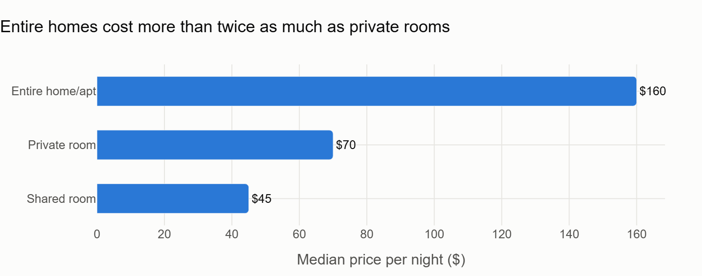
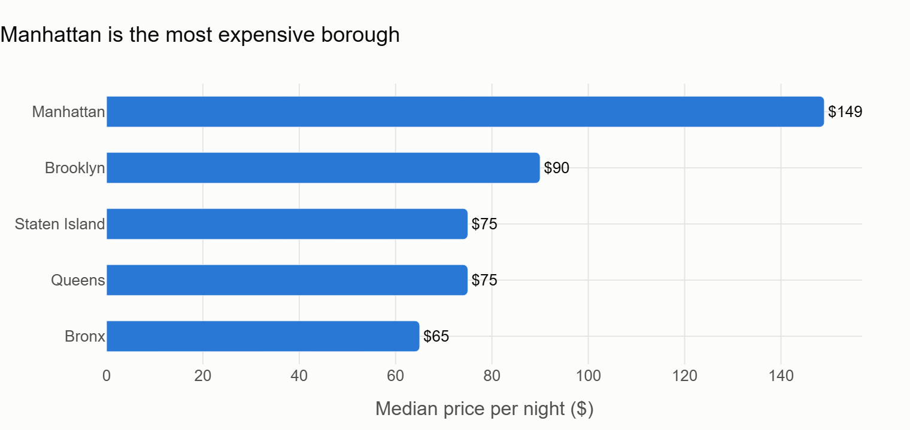
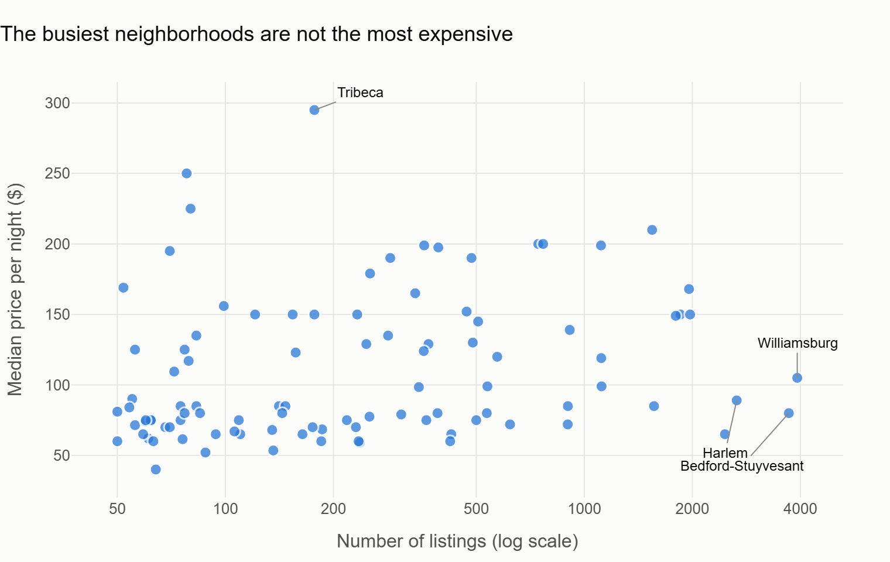
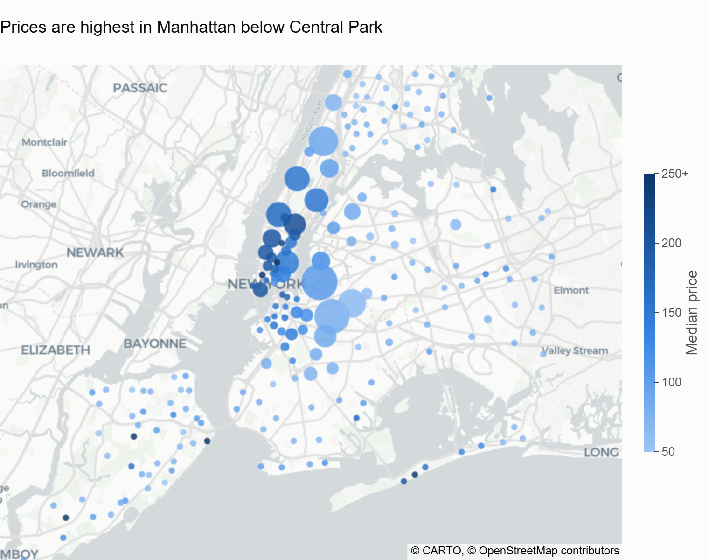
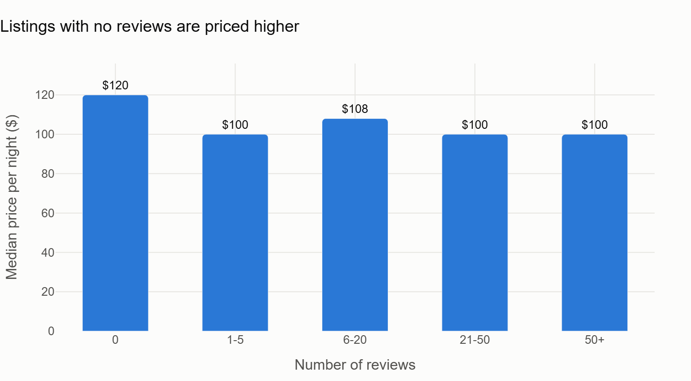

This project analyzes Airbnb listing data for New York City (2019) to uncover pricing trends, neighborhood insights, and property availability patterns. The dataset is cleaned, transformed, and stored in an SQLite database for efficient querying and analysis.

## Key Findings

Based on 48,631 listings after cleaning (see [Data Cleaning](#data-cleaning)). Prices are medians per night.

1. **Room type matters more for price than anything else.** An entire home or apartment has a median price of $160, a private room $70 and a shared room $45. Entire homes make up 52% of listings and private rooms 46%. Shared rooms are only 2%.

   

2. **Manhattan and Brooklyn make up 85% of the market, and Manhattan costs much more.** The median is $149 in Manhattan, $90 in Brooklyn, $75 in Queens and Staten Island, and $65 in the Bronx.

   

3. **The neighborhoods with the most listings are not the most expensive.** Williamsburg (3,908 listings), Bedford-Stuyvesant (3,699) and Harlem (2,651) have the most supply, at medians of $80–$105. The most expensive neighborhoods are small, high-end areas of Manhattan: Tribeca has a median of $282 across 165 listings.

   

   On a map, the most expensive neighborhoods cluster in Manhattan south of Central Park, while the largest markets (the biggest bubbles) are in north Brooklyn and Harlem at lower prices. Each bubble is one neighborhood: size shows the number of listings and color shows the median price.

   

4. **Listings with no reviews are priced about $20 higher, but beyond that, reviews don't track price.** Listings with no reviews have a median of $120, while every group with at least one review sits at $100–$108. One possible explanation is that new or overpriced listings struggle to get their first booking. This is a correlation, not proof of cause.

   

## SQL Highlights

`run_advanced_sql_queries()` in `main.py` uses CTEs and window functions to answer three more questions:

- **Who runs the market?** 86% of hosts have a single listing, but the other 14% control a third of all listings. Just 112 hosts (0.3%) have 10 or more listings each, together making up 6.5% of the market. *(CTEs + `SUM() OVER ()` for percentages of the total)*
- **What's the priciest area in each borough?** The top neighborhoods by average price are Tribeca ($330) in Manhattan, Cobble Hill and DUMBO (tied at $196) in Brooklyn, and Far Rockaway ($166) in Queens, a beach area. *(`RANK() OVER (PARTITION BY borough ...)` for a top 3 per group)*
- **What does each room type cost in each borough?** Calculated as medians, which SQLite has no built-in function for. A Manhattan entire home ($190) costs nearly three times a Brooklyn private room ($65). *(`ROW_NUMBER()` and `COUNT() OVER` to find the middle value)*

## Recommendations

- **Travelers on a budget:** a private room in Brooklyn (median $65) or Queens ($60) costs about a third of an entire home in Manhattan ($190).
- **New hosts:** listings without reviews are priced above reviewed ones. Pricing near the neighborhood median until the first few reviews come in may help win early bookings.
- **Hosts in Williamsburg, Bedford-Stuyvesant or Harlem:** these are the most crowded markets in the city, so competitive pricing and a strong listing matter more there than in areas with less supply.

## Data Cleaning

Before the analysis I removed 264 listings (0.5%) that don't represent realistic short-term rentals:

| Removed | Count | Why |
|---|---|---|
| Price of $0 | 11 | Data entry errors |
| Price over $1,000/night | 239 | Extreme values (up to $10,000) that distort averages and correlations |
| Minimum stay over 365 nights | 14 | Not short-term rentals |

I **kept** the 36% of listings with 0 days of availability. The data can't tell a fully booked listing apart from an inactive one, so removing them could drop some of the most popular listings.

**Correcting my first conclusion:** my first correlation check on the uncleaned data showed only a weak link between price and room type (Pearson -0.25), which suggested room type didn't matter much. That was misleading: the extreme prices pulled the result toward zero, and room type is a category rather than a number on a scale. After cleaning, Pearson rises to -0.46, and Spearman correlation, which compares rankings and isn't thrown off by extreme values, shows a strong relationship (-0.68). The median prices in Finding 1 confirm it.

## Charts

The charts above are made with Plotly in `main.py`. Running it saves each chart twice: as a PNG in `images/` and as an interactive HTML file in `charts/` (hover any bar or point for details). The HTML files can be embedded in a website with an `<iframe>`.

An earlier version of the analysis was also built as a Power BI dashboard (`Dashboard.pbix`, requires Power BI Desktop).

## How to Run

```
pip install -r requirements.txt
python main.py
```

This cleans `AB_NYC_2019.csv`, builds the SQLite database (`airbnb.db`), prints the SQL query results and regenerates the charts.

## Key Features

Data Cleaning: Handles missing values, converts categorical data (e.g., room types to numeric), and removes unnecessary columns.

SQLite Integration: Stores processed data in a structured database for easy access and scalability.

Exploratory Analysis: Examines correlations between price, location, room type, and reviews.

## Technologies Used

Python (Pandas, SQLite3)

SQL (Database management)

Data Visualization (Plotly and Power BI)

Goal: Provide insights for travelers, hosts, and real estate analysts on NYC Airbnb trends.
